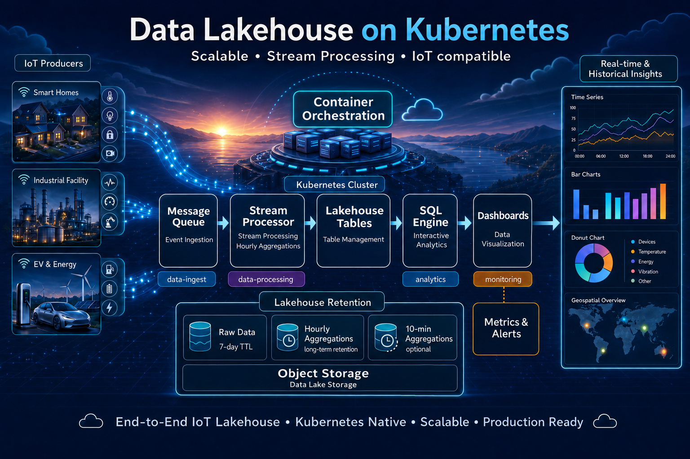
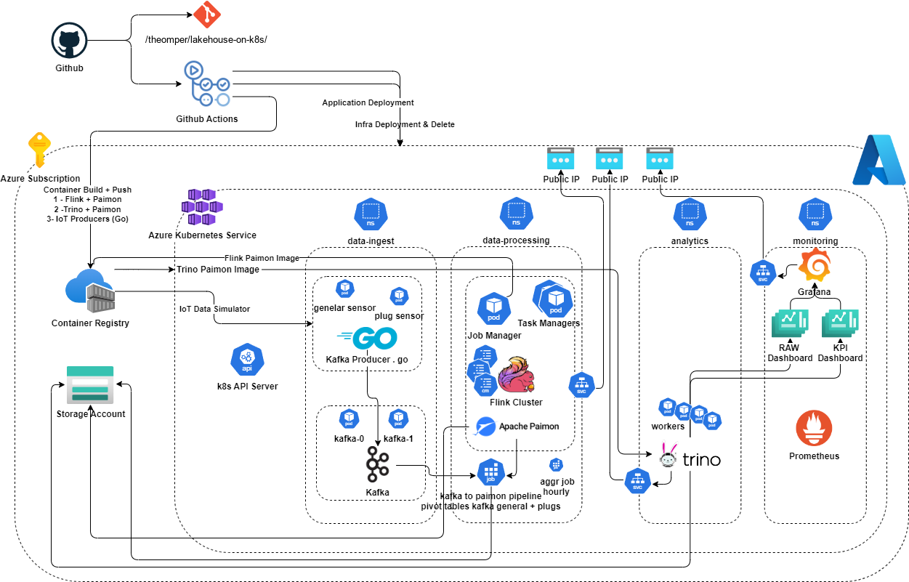

# lakehouse-on-k8s



A streaming **data lakehouse on Kubernetes** for IoT sensor data, built and
benchmarked as a diploma thesis at the School of Electrical and Computer
Engineering, National Technical University of Athens (NTUA).

Data flows from simulated IoT producers through **Kafka**, is processed in real
time by **Apache Flink**, stored as an open table format with **Apache Paimon**
on Azure Data Lake Storage Gen2, and queried with **Trino**. Everything is
provisioned on **Azure Kubernetes Service (AKS)** via Terraform and GitHub
Actions, and observed through **Prometheus and Grafana**.

> 📄 The full thesis is included as [`docs/thesis-lakehouse-on-k8s.pdf`](docs/thesis-lakehouse-on-k8s.pdf) (in Greek).
> A write-up in English is in [`docs/medium-article.md`](docs/medium-article.md).



See [`docs/architecture.md`](docs/architecture.md) for the detailed component and data-flow design.

---

## Platform stack

| Layer | Component | Purpose |
|---|---|---|
| **Infrastructure** | Azure Kubernetes Service (AKS) | Container orchestration |
| | Terraform (`infra/`) | IaC for AKS, ADLS Gen2, ACR |
| **Ingestion** | Apache Kafka (KRaft, 2 brokers) | Streaming ingestion of IoT data |
| **Processing** | Apache Flink (session cluster) | Stream processing plus batch aggregation, exactly-once |
| **Storage** | Apache Paimon on ADLS Gen2 | Lakehouse table format (`sensor_data_raw` / `_10min` / `_30min`) |
| **Query** | Trino | Distributed SQL over Paimon |
| **Observability** | Prometheus and Grafana | Metrics, dashboards, alerting |
| **Producers** | Go / Python (`docker/`) | Simulated IoT sensor data generators |
| **CI/CD** | GitHub Actions (`.github/workflows/`) | Build images, provision infra, deploy apps |

---

## Repository structure

```
lakehouse-on-k8s/
├── infra/               # Terraform: AKS, ADLS Gen2, ACR modules
├── k8s/
│   ├── manifests/       # Kafka, Flink jobs, Paimon bootstrap, aggregation CronJobs
│   ├── flink/           # Flink session cluster (JobManager, TaskManagers, config)
│   ├── flink-application/   # Flink Application Mode ingestion variant
│   ├── helm/            # Trino + kube-prometheus-stack values
│   └── producers/       # IoT producer Deployments (+ calibration/)
├── docker/              # Producer + Trino/Flink+Paimon image definitions and source
├── sql/
│   ├── flink/           # Paimon DDL + streaming ingest + aggregation SQL
│   └── trino/           # Q1–Q5 benchmark queries
├── grafana/             # Dashboards (energy KPIs, power quality, live raw, data trust)
├── scripts/             # Experiment orchestrator + operational PowerShell scripts
├── experiments/
│   ├── iot-sim-manifests/   # Generated per-tier producer manifests
│   └── results/         # Benchmark run data + consolidated experiment matrix
├── docs/                # Architecture, thesis PDF, articles
└── .github/workflows/   # CI/CD pipelines
```

> **Note on names.** All Azure resource names in this repository
> (`aks-lakehouse-on-k8s-01`, `stlakehouseonk8s01`, `acrlakehouseonk8s01`, and so
> on) are **placeholders**. Replace them in `infra/terraform.tfvars` and the
> workflow `env:` blocks with your own before deploying. No secrets are committed:
> all credentials are injected at runtime via Kubernetes Secrets and GitHub
> Actions secrets.

---

## How it works

1. **Producers** simulate homes, each emitting 1 general reading plus 4 plug
   readings per second (5 records/s/home) into the Kafka topics
   `iot-sensor-general` and `iot-sensor-plug`.
2. A **Flink streaming SQL job** consumes both topics with event-time watermarks
   and writes to the Paimon `sensor_data_raw` table on ADLS Gen2 with exactly-once
   processing. In practice, exactly-once means each Kafka record lands in Paimon
   one time even across failures: every 60-second Flink checkpoint records the
   Kafka offsets and commits a matching Paimon snapshot, so a recovery never loses
   or duplicates a record.
3. **Batch aggregation** jobs roll raw data up into `sensor_data_10min` and
   `sensor_data_30min` tables.
4. **Trino** queries the Paimon catalog directly for analytics, and **Grafana**
   visualizes energy KPIs, power quality, and live throughput.

## Running it

Provisioning is automated by `infra/` (Terraform or an Azure CLI script) and the
`infra-ci` / `apps-ci` GitHub Actions workflows; benchmarks are driven by
`scripts/run-experiment-combined-improved.ps1`. Per-folder details live next
to the code: [`k8s/README.md`](k8s/README.md) (manifests and deployment order),
[`scripts/README.md`](scripts/README.md) (VM setup, AKS access, experiment
orchestrator), and [`experiments/README.md`](experiments/README.md) (running the
benchmark).

---

## Benchmark results

The pipeline was evaluated across **ten load tiers**, from 50 to 17,500 simulated
homes (250 to 87,500 records/second), each with a 30-minute steady-state
measurement window, run for both an immediate-send and a batched Go producer.
Full per-tier data is in
[`experiments/results/`](experiments/results/experiment-matrix-combined-improved-08052026.md).

Selected figures (immediate-send phase, from the consolidated experiment matrix).
Q1 is a `COUNT(*)` over the raw table, and Q3 is a window function that computes a
trailing 60-row moving average of voltage per home:

| Target rec/s | Trino Q1 p95 (count) | Checkpoint failover |
|-------------:|---------------------:|:-------------------:|
| 250 | 3.9 s | none |
| 17,500 | 26.1 s | none |
| 50,000 | 79.8 s | none |
| 62,500 | 123.2 s | none |
| 75,000 | 252.8 s | first failover |
| 87,500 | Q3 fails | intermittent |

The headline finding is that the bottleneck does not sit inside the ingestion
layer or inside the analytics layer, but at the handoff between them. The system
accepts and durably stores data far faster than it can read that data back.

- **Ingestion held at the top of the range.** At 17,500 homes the pipeline
  sustained its full target of 87,500 records/second, matching the target to
  within one percent with zero producer errors at any tier, more than 200 million
  records committed in a single 30-minute window on a two-node user pool. The
  producers never saturated.
- **Reading the data back was the limit.** Trino's `COUNT(*)` (Q1) climbed from
  under 4 seconds to over 4 minutes as the raw table grew, and the window-function
  query (Q3) failed outright at the largest tier. The query engine hit its ceiling
  tens of thousands of records per second before ingestion did.
- **Batching before sending is decisively the right call.** At 10,000 homes the
  batched producer delivered the same records while cutting inbound network per
  Kafka broker from about 18.2 MiB/s to about 11.3 MiB/s, roughly 38 percent less.
- **Exactly-once has a locatable price.** The first Flink checkpoint failover
  appeared at 15,000 homes, where the coordinated flush and snapshot commit to
  object storage began missing its window. Below that, checkpoints were clean and
  lag stayed near zero.

The takeaway: on a modest AKS footprint of two user nodes, streaming ingestion
into a Kubernetes-native lakehouse scales cleanly to tens of thousands of records
per second, while interactive query latency and the snapshot commits behind
exactly-once become the binding constraints well before the producers do.

---

## License

Licensed under the [MIT License](LICENSE).
