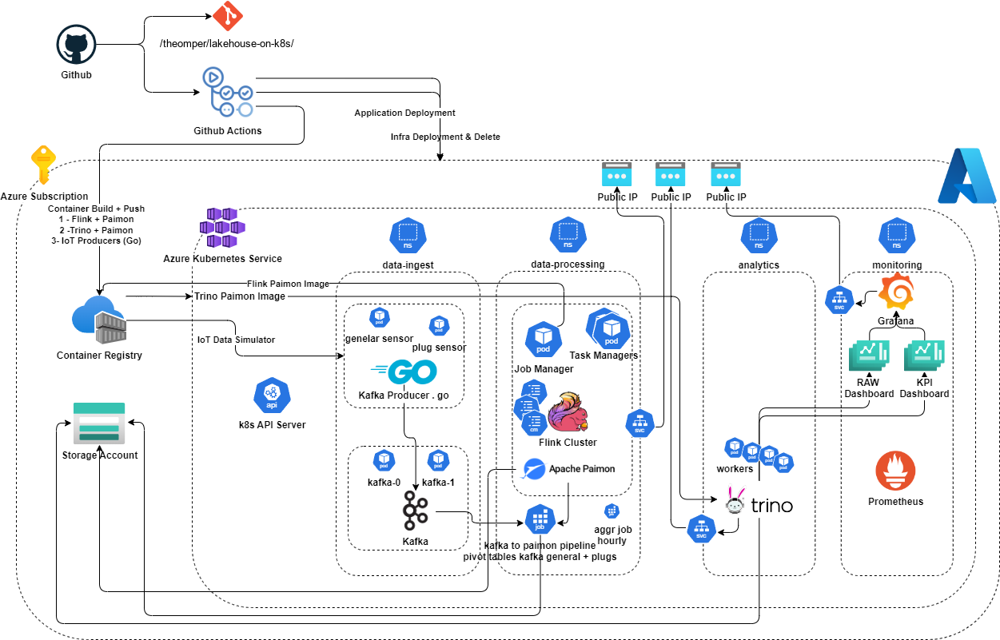

# A Streaming Data Lakehouse on Kubernetes, and What Broke First at 87,500 Records a Second

*Building an IoT lakehouse from Kafka, Flink, Paimon, and Trino on a two-node
Kubernetes cluster, and letting the benchmarks decide what actually scales.*

---

## The problem nobody warns you about

An IoT deployment is a firehose that never turns off. A single smart-home
gateway reporting a handful of plugs every second is trivial. Ten thousand of
them, each emitting five readings a second, is fifty thousand records per second,
forever. And the moment you have that much data, someone asks the inevitable
question: "Can you also let me query it?"

That second requirement is where most naive architectures fall apart. You can
build something that ingests fast, or something that queries well, but the
streaming pipeline and the analytical store usually pull in opposite directions.
The industry's fashionable answer is the lakehouse: keep the cheap, open-format
storage of a data lake, but add the transactional tables and SQL of a warehouse.

The non-obvious part is doing all of this on Kubernetes, self-managed, on a
deliberately modest cluster. No managed Databricks, no Snowflake, no cloud
data-warehouse SKU quietly autoscaling in the background. Just open-source
components, raw manifests, and a fixed resource budget. That was the bet behind
my diploma thesis: can a Kubernetes-native lakehouse actually hold up under real
IoT load, and where does it break first?

This article walks through the architecture, the trade-offs that mattered, and
the benchmark numbers that produced a genuinely counter-intuitive answer.

---

## The architecture



The data path is a straight line, and every hop is a first-class open-source
system running as pods:

```
IoT producers (Go / Python)
        |  5 records/s per simulated home
        v
Apache Kafka (KRaft, 2 brokers)          topics: iot-sensor-general, iot-sensor-plug
        |
        v
Apache Flink (session cluster)           streaming SQL, exactly-once
        |
        v
Apache Paimon on ADLS Gen2               sensor_data_raw -> _10min -> _30min
        |
        v
Trino  ---------->  Grafana              SQL analytics + dashboards
```

The whole thing runs on Azure Kubernetes Service across four namespaces:
`data-ingest` for Kafka and the producers, `data-processing` for Flink and the
Paimon jobs, `analytics` for Trino, and `monitoring` for Prometheus and Grafana.
The entire Azure footprint (AKS, ADLS Gen2, Azure Container Registry) is
provisioned by Terraform and deployed through GitHub Actions.

A few choices are worth dwelling on.

### Kafka in KRaft mode, no ZooKeeper

The ingestion tier is a two-broker Kafka StatefulSet running in KRaft mode, so
there is no separate ZooKeeper ensemble to babysit. Two topics carry the load:
`iot-sensor-general` with 4 partitions for the per-home reading, and
`iot-sensor-plug` with 8 partitions for the four per-plug readings, each
replicated across both brokers.

### Paimon as the table format

The lakehouse storage layer is Apache Paimon, writing to Azure Data Lake Storage
Gen2 over the `abfs://` filesystem. Flink registers it as a catalog, and
everything downstream, Trino included, reads the same tables directly from object
storage:

```sql
CREATE CATALOG IF NOT EXISTS paimon WITH (
  'type' = 'paimon',
  'warehouse' = 'abfs://warehouse@stlakehouseonk8s01.dfs.core.windows.net/paimon',
  'azure.account-name' = 'stlakehouseonk8s01',
  'property-version' = '1'
);
```

Raw records land in `sensor_data_raw`, and batch jobs roll them up into
`sensor_data_10min` and `sensor_data_30min`. There is no second copy of the data
in a warehouse. Trino queries the exact same Paimon files that Flink just wrote.

### Flink doing streaming and batch on the same slots

Flink runs as a session cluster: one JobManager and two TaskManagers, four task
slots each. The streaming Kafka-to-Paimon job takes half the slots, and the rest
are kept free so batch aggregation jobs can run concurrently on the same cluster:

```yaml
taskmanager.numberOfTaskSlots: 4
parallelism.default: 4

execution.checkpointing.mode: EXACTLY_ONCE
execution.checkpointing.interval: 60 s
execution.checkpointing.timeout: 600 s
execution.checkpointing.min-pause: 30 s
execution.checkpointing.tolerable-failed-checkpoints: 5
execution.checkpointing.dir: abfs://checkpoints@stlakehouseonk8s01.dfs.core.windows.net/flink-checkpoints
```

### What exactly-once actually means here

That checkpointing block is worth explaining in plain terms, because "exactly-once"
gets thrown around a lot and rarely defined. In this pipeline it means one thing:
every reading that Kafka accepts is reflected in the Paimon table exactly one
time, even if a TaskManager crashes and the job recovers. Not zero times because
a record was lost in a buffer, and not twice because the job replayed part of the
stream after a failure.

The mechanism is a handshake between Flink and Paimon. Every sixty seconds Flink
takes a checkpoint, which records the exact Kafka offsets the job has consumed.
That checkpoint also triggers the Paimon sink to flush its buffered rows as new
Parquet files and commit them as a new, atomic Paimon snapshot on ADLS Gen2.
Offsets and committed data advance together. If the job dies, Flink rewinds to
the last completed checkpoint and re-reads Kafka from those offsets, while Paimon
readers only ever see fully committed snapshots. Nothing half-written is visible,
and nothing already committed is redone.

This guarantee is not free, and the price shows up in two places that the
benchmarks measured directly. Data becomes queryable only after a checkpoint
commits, so freshness lags by up to a checkpoint interval plus the flush. And
holding those coordinated commits to object storage together is exactly what
starts to fail under load, as we will see. For the rest of this article I will
just say exactly-once and trust that the handshake is what I mean.

The next figure traces a single record all the way through, and shows where that
checkpoint-triggered flush and snapshot commit sit in the flow:


*End-to-end sequence for a single record. The Go simulator produces to Kafka,
Flink consumes both topics and writes to Paimon, and a checkpoint every sixty
seconds triggers the flush and snapshot commit that makes the data durable and
exactly-once. Trino then queries the committed Paimon tables and Grafana renders
them.*

---

## Two producers, one question about batching

The IoT simulators come in two variants, and comparing them was a deliberate
experiment rather than an accident of history. One sends each home's readings to
Kafka the moment they are produced. The other buffers readings and flushes them
to Kafka in larger, linger-tuned batches. Both deliver the same number of records
per second; the question was what that costs the brokers.

The answer was decisive, so it is worth stating as a number rather than a
sentiment. At the 10,000-home tier, the immediate-send producer drove roughly
18.2 MiB/s of inbound network into each Kafka broker. The batched producer
delivered the identical record count at roughly 11.3 MiB/s per broker, about 38
percent less. Broker CPU dropped in the same direction. Batching before sending
is not a marginal tuning knob here; it is the difference between comfortable and
constrained at the top of the range, bought with a small amount of producer-side
latency. If you take one operational lesson from this project, it is to batch
before you send.

---

## How the benchmark actually worked

Rather than one heroic load test, the pipeline was pushed through ten load tiers,
from 50 homes up to 17,500, which is 250 to 87,500 records per second. Each tier
ran twice, once per producer variant, and each run followed the same disciplined
lifecycle, fully automated by a PowerShell orchestrator.


*The eight-phase measurement cycle, repeated for every tier and both producer
variants. Each run resets the environment, redeploys and health-gates Flink,
warms up, takes a T0 baseline, holds a 30-minute steady-state window, snapshots
again, flushes with a 30-minute rollup, and collects metrics. (Some labels in
this thesis figure are in Greek.)*

In short, every run wipes the producers, Flink jobs, Kafka topics, and the Paimon
warehouse so it starts from a clean slate, then re-bootstraps the catalog and the
streaming job and verifies the job is genuinely running before proceeding. After
a warm-up it holds a 30-minute steady-state window, parses producer stats while
the pods are still alive so cumulative counters cannot over-report, snapshots
Prometheus, and finally flushes and runs the analytical query suite.

That suite is five Trino queries chosen to stress different query shapes against
the raw table: a plain `COUNT(*)` (Q1), a multi-aggregate `GROUP BY` (Q2), a
window function (Q3), a cross-table `JOIN` (Q4), and a percentile and `stddev`
computation (Q5). Q3 is the mean one, and it is worth being precise about what it
does, because "window function" alone hides the cost. It computes a trailing
60-row moving average of `voltage`, partitioned by `home_id` and ordered by
timestamp:

```sql
SELECT home_id, ts, voltage,
  AVG(voltage) OVER (
    PARTITION BY home_id
    ORDER BY ts
    ROWS BETWEEN 59 PRECEDING AND CURRENT ROW
  ) AS rolling_avg
FROM paimon.iot.sensor_data_raw
WHERE plug_id = 'general'
ORDER BY ts DESC
LIMIT 100;
```

To evaluate that `AVG(voltage) OVER (PARTITION BY home_id ORDER BY ts ...)`, Trino
has to partition the entire raw table by home and sort each partition by time.
It is exactly the kind of query an analyst writes without thinking, and exactly
the kind that scales terribly as the raw table grows.

Every run was captured as raw JSON, a wide CSV matrix, and a full transcript. The
consolidated results live in
[`experiments/results/`](../experiments/results/experiment-matrix-combined-improved-08052026.md).

---

## The results, and where the system actually bends

Here is the finding that reframed the whole project. The bottleneck is not inside
the ingestion layer, and it is not inside the analytics layer either. It sits at
the handoff between them: the system can accept and durably store data far faster
than it can read that same data back interactively, and the gap between those two
rates widens with every tier.

Look at the two halves separately and the point becomes obvious.

Ingestion was the easy part. At the top tier of 17,500 homes the pipeline
sustained its full target of 87,500 records per second, with the observed
producer rate matching the target to within one percent and zero producer errors
at any tier. That is more than 200 million records committed in a single
30-minute window, on a user node pool of just two machines. The producers never
saturated, not once. If ingestion were the whole story, the conclusion would be
boring: it just works.

Reading the data back was the hard part. While Kafka and Flink shrugged off the
load, Trino's query latency over the growing raw table climbed super-linearly:

| Target rec/s | Trino Q1 `COUNT(*)` p95 |
|-------------:|------------------------:|
| 250 | 3.9 s |
| 17,500 | 26.1 s |
| 50,000 | 79.8 s |
| 62,500 | 123.2 s |
| 75,000 | 252.8 s |
| 87,500 | Q3 fails |

A `COUNT(*)`, the cheapest query in the book, went from under four seconds to over
four minutes. By 75,000 records per second the trailing-average window query (Q3)
was straining, and at the top tier it failed outright. The producers were still
perfectly happy while the query engine had already fallen over.

The durability handshake bends at the same boundary. The first Flink checkpoint
failover appeared at the 15,000-home tier, where the coordinated flush and
snapshot commit to object storage began to miss its window and force recovery.
Below that point checkpoints were clean and consumer lag stayed near zero. Above
it, the exactly-once guarantee became the thing you pay for in stability rather
than throughput, since raw throughput itself never dropped.

Read together, all three signals point at the same seam. Writing raw records into
the lakehouse stayed cheap and reliable to the very top of the range. Turning that
ever-larger pile of raw records back into answers, whether by an interactive Trino
scan or by the checkpoint that has to commit a consistent snapshot of it, is what
ran out of headroom first. The layers were fine; the transition between them was
not.

---

## What the numbers actually teach you

The headline is the seam, not either layer. On a Kubernetes-native lakehouse
running on unremarkable hardware, a Kafka, Flink, and Paimon pipeline ingested
87,500 records per second with zero errors, while the analytics side, full-scan
queries over the raw table and the snapshot commits that back them, hit its limit
tens of thousands of records per second earlier. When you plan capacity for a
setup like this, the ingestion tier is not where the next dollar should go.

Batching before sending is the clearest single win on the ingestion side. Cutting
inbound broker traffic from about 18.2 to about 11.3 MiB/s at 10,000 homes, for
the same delivered records, is real and measured headroom, not a rounding-error
optimisation.

And exactly-once has a concrete, locatable price. The checkpoint-failover
threshold sat at 15,000 homes on this budget, and it moves with your TaskManager
count and your object-storage throughput. Knowing where that line is worth more
than any general reassurance that the guarantee "just works," because it is the
first place a bigger workload will hurt.

None of this is a knock on the lakehouse pattern. A self-managed, Kubernetes-native
lakehouse held 87,500 records per second with zero ingestion errors on a two-node
user pool. The lesson is about where to spend the next dollar, and on this
evidence it goes to the read and query side of the seam: more Trino workers,
pre-aggregated tables, and partition pruning, long before it goes to ingestion.

---

## Try it, read more

- **Repository:** [`github.com/theomper/lakehouse-on-k8s`](https://github.com/theomper/lakehouse-on-k8s),
  with the Terraform, Kubernetes manifests, Flink and Trino SQL, Grafana
  dashboards, the experiment orchestrator, and every raw benchmark run.
- **Full thesis** (Greek): [`docs/thesis-lakehouse-on-k8s.pdf`](thesis-lakehouse-on-k8s.pdf), *"Design and
  Implementation of a Distributed System using Kubernetes, Kafka, and a Data Lake
  for IoT Data Management."*
- **Architecture detail:** [`docs/architecture.md`](architecture.md).

*All figures in this article come directly from the benchmark data files in the
repository. Azure resource names shown are placeholders.*
